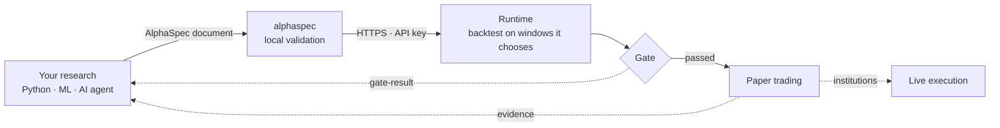

# AlphaSpec

**A business language for trading strategies that humans, AI agents and execution systems can all read, check and agree on.**

[中文说明](https://github.com/openalpha-dev/alphaspec/blob/main/README.zh-CN.md) ·
[Spec](https://github.com/openalpha-dev/alphaspec/blob/main/docs/SPEC.md) ·
[Lint rules](https://github.com/openalpha-dev/alphaspec/blob/main/docs/RULES.md) ·
[Runtime API](https://github.com/openalpha-dev/alphaspec/blob/main/docs/RUNTIME_API.md) ·
[Reference runtime: EasyQuant](https://www.goeasyquant.com)

AlphaSpec is an open specification for handing a trading strategy, or a model's output, to an
execution system. A strategy is a JSON document: indicators, entry and exit conditions, universe
and risk settings. There is no code in it, so everything that matters can be checked before
anything runs, by a validator, by a risk reviewer, or by the AI that wrote it.

```bash
pip install "alphaspec[mcp]"
alphaspec validate my_strategy.json
```

## Why a strategy DSL, and why now

> **The bottleneck of AI-driven research was never the model. It is the missing feedback loop: a
> model never learns what its signals did in a real market.**

**AI made writing strategies cheap. It did not make trusting them cheap.** An agent can produce a
hundred candidate strategies in an afternoon. What it cannot do on its own is tell which of them
survive look-ahead bias, multiple testing and real trading rules. The bottleneck has moved from
*producing* ideas to *verifying* them, and verification needs something both sides can read.

Generated code is the wrong medium for that. It is different every time, reveals what it does only
when executed, needs a sandbox, and a risk desk cannot approve it line by line. A declarative
document can be:

- **validated on the spot** by a schema and semantic lint rules, with no sandbox;
- **constrained at generation time**, so a model can only emit well-formed documents;
- **diffed**: "the oversold threshold changed from 30 to 28" is a change a person can review;
- **audited** field by field by a risk desk;
- **free of injection surface**: there is nowhere to put code.

That makes AlphaSpec a **business language between people and machines**. A person states an idea in
plain words; an agent turns it into a document built from a shared vocabulary of indicators whose
meaning, units and pitfalls are written down; the validator says exactly what is wrong and why; the
runtime executes the same document the person reviewed. Every party is looking at the same thing.

AlphaSpec is **not trying to replace Python**. Research in whatever you like: pandas, PyTorch,
LightGBM, any agent framework. AlphaSpec is the boundary: what crosses into execution must be a
document that can be checked, compared and audited.

## What it defines

Two ways in, written by you or your agent:

| Level | Document | For | You send |
|---|---|---|---|
| **L1 · Score** | [`score`](https://github.com/openalpha-dev/alphaspec/blob/main/schema/0.4/score.schema.json) | ML teams, factor researchers | `(asOf, market, symbol, score)` or target weights |
| **L2 · Artifact** | [`artifact`](https://github.com/openalpha-dev/alphaspec/blob/main/schema/0.4/artifact.schema.json) | rule-based strategies, AI agents | a rule tree with parameters, universe and risk overrides |

Two ways back, written by the runtime and never by the submitter:

| Document | What it answers |
|---|---|
| [`gate-result`](https://github.com/openalpha-dev/alphaspec/blob/main/schema/0.4/gate-result.schema.json) | Did it pass, judged on figures the runtime **recomputed itself**, check by check |
| [`evidence`](https://github.com/openalpha-dev/alphaspec/blob/main/schema/0.4/evidence.schema.json) | What happened in a real market: rejections, slippage, fills, deviation from target, every number with its caliber |

The way back is the point. Research tools see prices, news and filings; none of that says whether
an order was rejected, how much slippage it paid, or how far the portfolio drifted from its target.
Only an execution system knows, and only if it reports it in a form the research side can read.
`gate-result` and `evidence` are that form: the feedback loop the model was missing.



A short artifact:

```json
{
  "contractVersion": "0.4",
  "kind": "artifact",
  "title": "RSI rebound above the 60-day average",
  "market": "cn_stock",
  "timeframe": "1d",
  "dsl": {
    "version": 1,
    "params": { "oversold": 30 },
    "indicators": {
      "rsi":  { "type": "RSI", "period": 14 },
      "ma60": { "type": "SMA", "period": 60 }
    },
    "entry": { "type": "AND",
      "left":  { "type": "CROSS_UP", "left": { "ind": "rsi" },   "right": { "ref": "oversold" } },
      "right": { "type": "GT",       "left": { "ind": "close" }, "right": { "ind": "ma60" } } },
    "exit":  { "type": "GTE", "left": { "ind": "rsi" }, "right": { "const": 70 } }
  },
  "exits":  { "stopLossPct": 8, "noNewHighDays": 20 },
  "sizing": { "positionMode": "FIXED_PCT", "targetPctPerOrder": 20 },
  "universe": { "mode": "SYMBOLS", "symbols": ["600519.SH", "000333.SZ"] },
  "producer": { "kind": "AI_AGENT", "name": "my-agent@0.1", "searchTrials": 3 }
}
```

`producer.searchTrials` is how many candidates the search tried, discarded ones included. The more
you tried, the higher the bar the gate sets, so luck is not mistaken for skill.

## How a submission runs today

The reference runtime is **EasyQuant**. A submitted artifact goes through the same path a strategy
built in its own UI does:

1. **Validate twice.** Locally by `alphaspec`, then again by the runtime, which also compiles the
   rule tree in its own engine.
2. **Backtest on windows the runtime chooses.** One continuous backtest, reported as two segments:
   for daily strategies the last 4 years in-sample and the most recent year out-of-sample; for
   intraday strategies 18 months and 6 months. Returns are annualised on trading time; China's T+1,
   price limits and lot sizes apply.
3. **Gate, check by check.** In-sample return, drawdown and Sharpe; out-of-sample performance
   **relative to the market index** over the same period; a Deflated Sharpe test that uses
   `searchTrials`; structural look-ahead checks. Each check returns its metric, actual value,
   threshold and a hint, so an agent can act on it instead of guessing.
4. **Promote to paper trading.** A passing artifact becomes a paper-trading strategy in the
   submitter's account, created disabled; the person starts it.
5. **Go live, for institutions.** On the institutional edition the same strategy runs against
   broker counters through the same risk checks and ledger, and execution evidence flows back.

An API key can submit, evaluate, read results and promote. It cannot place orders or touch
accounts. An agent passes through exactly the same door as a person.

## About EasyQuant

[EasyQuant](https://www.goeasyquant.com) is a quantitative strategy delivery platform: research,
backtesting, paper trading and live execution on one engine, so the number you saw in a backtest is
computed the same way as the order that reaches the market. It is built around four principles:
**explainable** (every signal, rejection and fill carries a reason), **reproducible** (one engine for
backtest, paper and live), **operable** (monitoring, alerting, reconciliation) and **extensible**
(new markets, data sources and counters plug in behind stable interfaces).

- **Markets**: China A-shares, ETFs and convertible bonds, futures and options, Hong Kong and US
  equities, crypto spot.
- **Execution**: broker and exchange counters such as CTP, XTP, QMT, PTrade, TORA and IBKR; pre-trade
  risk checks on a single order path; a cash and position ledger reconciled against the broker.
- **Research**: 220+ indicators and chart patterns with written semantics (the same catalog
  AlphaSpec ships), factor research, visual rule canvas, stock pools, parameter scans with
  out-of-sample validation.
- **Built-in AI research**: describe what you want in plain words. *AI stock screening* turns
  "low valuation, high dividend, no ST" into screening conditions you can adjust, shows the
  candidates and why each was picked, and saves them as a stock pool. *AI strategy drafting* turns a
  trading idea into entry, exit and risk rules, validates them, opens them on the visual canvas with
  buy and sell points previewed, and from there into backtesting and paper trading. Nothing is saved
  or run until you confirm.
- **Two editions**: an institutional console for funds, brokerage quant desks and studios, including
  live trading; and a [personal edition](https://trade.goeasyquant.com) with AI-assisted research,
  backtesting and paper trading, where any user can create an AlphaSpec API key for free.

### AI writes the same document you would

A strategy drafted by EasyQuant's AI, one built by hand on its canvas, and one submitted as AlphaSpec by
an outside agent are the **same kind of object**: a rule tree from the same indicator vocabulary,
compiled by the same engine, backtested under the same rules and judged by the same gate. The AI does
not produce a pile of code that differs every run and can only be proven right by running it. It
produces a document you can read before it runs, change by hand, compare with the last version, and
hand back to the AI to improve. That is what makes AI output something a person can take
responsibility for.

## An open ecosystem

AlphaSpec lives under **[openalpha-dev](https://github.com/openalpha-dev)**, a family of open
components around one idea: alpha should be easy to express, honest to evaluate and safe to execute.

- **Any runtime can implement it.** A compliant runtime must pass every case in
  [`conformance/cases`](https://github.com/openalpha-dev/alphaspec/tree/main/conformance/cases).
  EasyQuant is the reference, not the gatekeeper.
- **Any agent can use it.** The Agent Skill and MCP server work with Claude Code, Cursor, Codex and
  any MCP client. EasyQuant's own AI research assistant uses the same public API and nothing more:
  if it needed a private shortcut, the ecosystem would not be real.
- **More components to come**, including **AlphaSpace**, a local research desk that brings your own
  model, data and LLM key and submits through the same API, and pieces of the execution stack such as
  risk checks, published as independent modules.

## Getting started

### Command line and Python

```bash
pip install alphaspec
alphaspec examples                        # documents to start from
alphaspec catalog --search breakout       # indicators, with meaning, parameters and pitfalls
alphaspec validate my_strategy.json       # errors and warnings, each with a fix hint
alphaspec rules --explain AS003           # why a rule exists
```

Submitting to a runtime (EasyQuant: create the key under *Account → API Keys*):

```bash
export ALPHASPEC_BASE_URL=https://trade.goeasyquant.com
export ALPHASPEC_API_KEY=eqk_...

alphaspec whoami
alphaspec submit my_strategy.json --evaluate --promote
```

```python
from alphaspec import Client

c = Client()                       # reads ALPHASPEC_BASE_URL and ALPHASPEC_API_KEY
aid = c.submit(doc)["artifactId"]  # validates locally first
c.evaluate(aid)
gate = c.wait(aid)
if gate["passed"]:
    c.promote(aid, name="my strategy")
```

### Agent Skill (agents that can run commands)

```bash
alphaspec skill --install ~/.claude/skills   # or your agent's skills directory
```

This installs two skills. `alphaspec` teaches the agent to write and submit strategies: start from an
example, look indicators up instead of guessing, validate until clean, report `searchTrials` honestly,
never quote numbers the runtime did not return. `alphaspec-diagnose` teaches it to diagnose a strategy
that is already running from the runtime's execution evidence: did it run, what was rejected and how
to fix it, did the holdings match the target, what execution cost, and only then whether the signal
itself is the problem.

### MCP (agents without a shell)

```json
{
  "mcpServers": {
    "alphaspec": {
      "command": "alphaspec-mcp",
      "env": {
        "ALPHASPEC_BASE_URL": "https://trade.goeasyquant.com",
        "ALPHASPEC_API_KEY": "eqk_..."
      }
    }
  }
}
```

The client speaks MCP to a local `alphaspec-mcp` process over stdio; that process calls the runtime
over HTTPS with the same client as the CLI, so the key only ever goes to the runtime. Tools:
`validate`, `explain_rule`, `search_indicators`, `get_indicator`, `get_schema`, `list_examples`,
`get_example`, `get_doc` (offline) and `whoami`, `submit`, `evaluate`, `gate_result`,
`list_submissions`, `promote` (runtime). There is no order tool.

## Lint rules are where the experience lives

Each rule in [docs/RULES.md](https://github.com/openalpha-dev/alphaspec/blob/main/docs/RULES.md)
exists because a runtime once accepted that mistake, ran it, and produced wrong numbers without an
error. Some examples:

- **AS003**: a daily indicator read from the still-forming daily bar inside an intraday strategy.
  In a backtest that bar already contains the close: look-ahead.
- **AS001**: an indicator alias with a typo. The rule compiles to nothing and never fires.
- **AS011**: `600000` instead of `600000.SH`. On venue-qualified markets the bare code is a
  different series.
- **AS012**: AI-generated output that does not report how many candidates were tried, which leaves
  nothing to correct a multiple-testing-inflated Sharpe ratio with.

The indicator catalog carries the same kind of knowledge: `close > DAY_HIGH` can never be true
because the day's high includes the current bar; the catalog says so and points to
`DAY_HIGH_BEFORE`.

## Markets

Market rules are scoped, not removed. Core indicators work on any market. Indicators that encode a
market's own rules, such as China's daily price limits, belong to an extension profile and are
rejected where those rules do not exist. See
[docs/MARKETS.md](https://github.com/openalpha-dev/alphaspec/blob/main/docs/MARKETS.md).

## Repository layout

```
schema/0.1/          JSON Schemas: the normative contract
catalog/             indicator catalog with semantics (Chinese and English)
conformance/cases/   accept/reject cases every compliant runtime must agree with
examples/            documents that pass with zero issues
src/alphaspec/       validator, CLI, runtime client, MCP server
skills/              Agent Skills (alphaspec, alphaspec-diagnose)
docs/                semantics, lint rules, markets, runtime API
```

## Versioning

Every document carries `contractVersion`, so a runtime can refuse what it does not understand.
Versions are additive and each keeps its own schema directory: a document is validated
against the version it declares. 0.2 adds trade settings (`exits`, `sizing`, `execution`);
see [docs/ROADMAP.md](https://github.com/openalpha-dev/alphaspec/blob/main/docs/ROADMAP.md). Schemas are published at their `$id` URLs, e.g.
`https://openalpha-dev.github.io/alphaspec/schema/0.4/artifact.schema.json`.

## License

Apache-2.0
