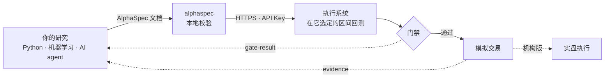

# AlphaSpec

**一份人、AI 和执行系统都读得懂、查得了、对得上的量化策略业务语言。**

[English](https://github.com/openalpha-dev/alphaspec/blob/main/README.md) ·
[字段语义](https://github.com/openalpha-dev/alphaspec/blob/main/docs/SPEC.md) ·
[检查规则](https://github.com/openalpha-dev/alphaspec/blob/main/docs/RULES.md) ·
[运行时接口](https://github.com/openalpha-dev/alphaspec/blob/main/docs/RUNTIME_API.md) ·
[参考执行系统：EasyQuant 易量策略](https://www.goeasyquant.com)

AlphaSpec 是一份开放规范，约定把一条交易策略、或者一个模型的输出，交给执行系统时用什么格式。
策略写成一份 JSON：用哪些指标、什么时候进、什么时候出、交易哪些标的、风控怎么设。
文档里不含任何代码，所以在真正运行之前，所有关键内容都能先被检查一遍——
被校验器检查，被风控人员审阅，也被写出它的 AI 自己检查。

```bash
pip install "alphaspec[mcp]"
alphaspec validate my_strategy.json
```

## 为什么要一份策略 DSL，为什么是现在

> **AI 投研的瓶颈从来不是模型，而是没有闭环反馈：模型永远不知道，自己的信号在真实市场里发生了什么。**

**AI 让「写策略」变得很便宜，但没有让「相信策略」变便宜。**
一个 agent 一下午能产出上百条候选策略，可它自己说不清哪几条经得起前视偏差、多重检验和真实交易规则的考验。
瓶颈已经从「产生想法」转移到「验证想法」，而验证需要一样双方都能读懂的东西。

生成代码不适合做这件事：每次生成都不一样，只有跑起来才知道它做了什么，必须养一个沙箱，
风控也没法逐行批准它上实盘。声明式文档则可以：

- **当场校验**：JSON Schema 加语义检查规则，不需要沙箱；
- **生成时约束**：可以强制模型只输出合法的文档；
- **可以 diff**：「超卖阈值从 30 改成 28」是人能看懂、能评审的改动；
- **可以审计**：风控逐字段审阅；
- **没有注入面**：文档里根本没有放代码的地方。

所以 AlphaSpec 本质上是**人与机器之间的一份业务语言**。
人用大白话说出想法；agent 把它写成文档，用的是一套共享的指标词汇，每个指标的含义、单位和常见坑都写在目录里；
校验器指出哪里错了、为什么错；执行系统运行的，正是人审过的那一份。所有参与方看的是同一个东西。

AlphaSpec **不打算取代 Python**。研究用什么都行：pandas、PyTorch、LightGBM、任何 agent 框架。
AlphaSpec 守的是那道边界：**跨进执行层的东西，必须是一份能校验、能比对、能审计的文档。**

## 它约定了什么

两种提交方式，由你或你的 agent 来写：

| 档位 | 文档 | 适合谁 | 提交什么 |
|---|---|---|---|
| **L1 · Score** | [`score`](https://github.com/openalpha-dev/alphaspec/blob/main/schema/0.1/score.schema.json) | 机构 ML 团队、因子研究员 | `(asOf, market, symbol, score)`，或者直接给目标权重 |
| **L2 · Artifact** | [`artifact`](https://github.com/openalpha-dev/alphaspec/blob/main/schema/0.1/artifact.schema.json) | 规则策略、AI agent | 一棵完整的规则树，加上参数、标的范围和风控设置 |

两种回执，只由执行系统生成，提交方不能自己填：

| 文档 | 回答什么问题 |
|---|---|
| [`gate-result`](https://github.com/openalpha-dev/alphaspec/blob/main/schema/0.1/gate-result.schema.json) | 门禁过没过。绩效由执行系统**自己重算**，逐项列出判据 |
| [`evidence`](https://github.com/openalpha-dev/alphaspec/blob/main/schema/0.1/evidence.schema.json) | 在真实市场里发生了什么：拒单、滑点、成交、与目标持仓的偏差，每个数字都注明口径 |

回执才是重点。研究端看得到行情、新闻和研报，却看不到一笔委托有没有被拒、付了多少滑点、
组合离目标持仓偏了多远——这些只有执行系统知道，而且只有当它用研究端读得懂的格式说出来，才算数。
`gate-result` 和 `evidence` 就是这种格式，也就是模型一直缺的那段闭环反馈。EasyQuant 要补上的，正是这一段。



一份简短的策略：

```json
{
  "contractVersion": "0.1",
  "kind": "artifact",
  "title": "RSI 超卖反弹 + 站上 60 日线",
  "market": "cn_stock",
  "timeframe": "1d",
  "dsl": {
    "version": 1,
    "params": { "oversold": 30 },
    "indicators": {
      "rsi":  { "type": "RSI", "period": 14 },
      "ma60": { "type": "SMA", "period": 60 }
    },
    "entry": { "type": "AND",
      "left":  { "type": "CROSS_UP", "left": { "ind": "rsi" },   "right": { "ref": "oversold" } },
      "right": { "type": "GT",       "left": { "ind": "close" }, "right": { "ind": "ma60" } } },
    "exit":  { "type": "GTE", "left": { "ind": "rsi" }, "right": { "const": 70 } }
  },
  "universe": { "mode": "SYMBOLS", "symbols": ["600519.SH", "000333.SZ"] },
  "producer": { "kind": "AI_AGENT", "name": "my-agent@0.1", "searchTrials": 3 }
}
```

`producer.searchTrials` 填这次搜索一共试过多少个候选，丢掉的也要算。
试得越多，门禁的要求就越高，这样运气就不会被当成能力。

## 一份提交现在怎么跑

参考执行系统是 **EasyQuant 易量策略**。通过 AlphaSpec 提交的策略，和在它界面里搭出来的策略走的是同一条路：

1. **两道校验。** 先由 `alphaspec` 在本地校验，执行系统再校验一遍，并用自己的引擎真实编译规则树。
2. **在执行系统选定的区间回测。** 一次连续回测，分成两段统计：日线策略取最近 4 年为样本内、最近 1 年为样本外；
   分钟级策略取 18 个月和 6 个月。年化按交易时间计算，A 股的 T+1、涨跌停和整手规则都会生效。
3. **逐项门禁。** 样本内的收益、回撤和夏普；样本外同期**相对市场指数**的表现；
   用 `searchTrials` 做的 Deflated Sharpe 多重检验；结构性前视检查。
   每一项都返回指标名、实际值、门槛和修改建议，agent 可以照着改，而不是猜数字的意思。
4. **转为模拟策略。** 门禁通过后，成为提交者账户里的一条模拟策略，默认停用，由本人启动。
5. **机构版接实盘。** 在机构版里，同一条策略经同一套风控和资金账本接到券商柜台，执行证据再回流给研究端。

API Key 能提交、评估、读结果、转模拟；不能下单，也碰不到账户。
**agent 走的是和人完全相同的那道门。**

## 关于 EasyQuant 易量策略

[EasyQuant](https://www.goeasyquant.com) 是一个量化策略交付平台：研究、回测、模拟和实盘跑在同一套引擎上，
回测里看到的数字，和真正发到市场的委托，是用同一种方式算出来的。平台围绕四条原则构建：

- **可解释**：每一个信号、每一次拒单、每一笔成交都带着原因；
- **可复现**：回测、模拟、实盘同一引擎、同一口径；
- **可运维**：监控、告警、对账一应俱全；
- **可扩展**：新市场、新数据源、新柜台在稳定接口后面接入。

主要能力：

- **市场**：A 股股票、ETF、可转债，期货与期权，港股、美股，加密货币现货。
- **执行**：对接 CTP、XTP、QMT、PTrade、TORA、IBKR 等柜台；所有委托经同一条下单通道做事前风控；资金与持仓账本和券商对账。
- **研究**：220 多个指标与 K 线/几何形态，每个都有写清楚的语义（也就是 AlphaSpec 附带的那份目录）；
  因子研究、可视化规则画布、股票池、带样本外验证的参数扫描。
- **内置 AI 投研**：用大白话说出你想要什么。
  **AI 选股**把「低估值、高分红、排除 ST」整理成可以调整的筛选条件，列出候选和每只入选的依据，确认后保存为股票池；
  **AI 生成策略**把交易想法整理成入场、退出和风控规则，先做校验，再在可视化画布上预览买卖点，
  然后进入回测和模拟交易。每一步保存和运行，都由你确认。
- **两个版本**：面向私募、券商量化部门、资管团队和投资工作室的**机构版**，含实盘交易；
  面向个人的[**个人版**](https://trade.goeasyquant.com)，提供 AI 投研、回测与模拟交易，
  任何用户都可以免费生成 AlphaSpec API Key。

### AI 写出来的，和你亲手搭的是同一份东西

EasyQuant 的 AI 生成的策略、你在画布上亲手搭的策略、外部 agent 通过 AlphaSpec 提交的策略，**是同一种东西**：
同一套指标词汇组成的规则树，同一个引擎编译，同一套规则回测，同一道门禁评判。

AI 不是生成一堆代码——每次都不一样，只有跑起来才知道对不对；
它生成的是一份文档：运行之前就能读懂，可以手工修改，可以和上一版逐项对比，也可以交回给 AI 继续改进。
正因为如此，AI 的产出才是一个人敢于为之负责的东西。

## 一个开放的生态

AlphaSpec 属于 **[openalpha-dev](https://github.com/openalpha-dev)**——一组围绕同一个理念的开源组件：
**alpha 应该容易表达、被诚实评估、被安全执行。**

- **任何执行系统都可以实现它。** 兼容本规范的执行系统，必须通过
  [`conformance/cases`](https://github.com/openalpha-dev/alphaspec/tree/main/conformance/cases) 里的全部用例。
  EasyQuant 是参考实现，不是守门人。
- **任何 agent 都可以使用它。** Agent Skill 和 MCP server 适用于 Claude Code、Cursor、Codex 以及任何 MCP 客户端。
  EasyQuant 自己的 AI 投研助手，用的也只是同一套公开接口：如果它需要走私有捷径，这个生态就是假的。
- **更多组件陆续开放**：包括 **AlphaSpace**——一个跑在你自己电脑上的研究台，用你自己的模型、数据和大模型 Key，
  通过同一套接口提交；以及从执行栈中拆出的风控等独立模块。

## 上手

### 命令行与 Python

```bash
pip install alphaspec
alphaspec examples                        # 可以直接改的示例文档
alphaspec catalog --search 突破           # 查指标：含义、参数、常见坑
alphaspec validate my_strategy.json       # 错误和警告，每条都带修改建议
alphaspec rules --explain AS003           # 某条规则为什么存在
```

提交到执行系统（EasyQuant：在「个人中心 → API Keys」生成 Key）：

```bash
export ALPHASPEC_BASE_URL=https://trade.goeasyquant.com
export ALPHASPEC_API_KEY=eqk_...

alphaspec whoami
alphaspec submit my_strategy.json --evaluate --promote
```

```python
from alphaspec import Client

c = Client()                       # 读取 ALPHASPEC_BASE_URL 和 ALPHASPEC_API_KEY
aid = c.submit(doc)["artifactId"]  # 先本地校验再提交
c.evaluate(aid)
gate = c.wait(aid)
if gate["passed"]:
    c.promote(aid, name="我的策略")
```

### Agent Skill（能执行命令的 agent）

```bash
alphaspec skill --install ~/.claude/skills   # 或者你的 agent 的技能目录
```

Skill 教给 agent 一套做法：从示例起步、查目录而不是猜指标名、校验到零错误、如实填写 `searchTrials`、
不引用执行系统没有返回的数字。

### MCP（没有命令行的 agent）

```json
{
  "mcpServers": {
    "alphaspec": {
      "command": "alphaspec-mcp",
      "env": {
        "ALPHASPEC_BASE_URL": "https://trade.goeasyquant.com",
        "ALPHASPEC_API_KEY": "eqk_..."
      }
    }
  }
}
```

客户端通过 stdio 用 MCP 协议和本机的 `alphaspec-mcp` 进程通信，这个进程再用和命令行相同的客户端经 HTTPS 调执行系统，
API Key 只会发给执行系统。工具：`validate`、`explain_rule`、`search_indicators`、`get_indicator`、`get_schema`、
`list_examples`、`get_example`、`get_doc`（离线可用），以及 `whoami`、`submit`、`evaluate`、`gate_result`、
`list_submissions`、`promote`（需要连执行系统）。没有任何下单工具。

## 检查规则里沉淀的是经验

[docs/RULES.md](https://github.com/openalpha-dev/alphaspec/blob/main/docs/RULES.md) 里的每条规则，
都来自一个真实发生过的错误：执行系统接受了它、跑了起来、给出了错误的结果，却从来没有报错。举几个例子：

- **AS003**：分钟策略里读了还没收盘的日线指标。回测时那根日线已经包含了收盘价，这就是前视。
- **AS001**：指标别名写错一个字母。规则编译出来是空的，永远不会触发。
- **AS011**：写了 `600000` 而不是 `600000.SH`。在需要交易所后缀的市场，裸代码是另一条序列。
- **AS012**：AI 生成的策略没报告试过多少个候选，多重检验虚高的夏普就无从校正。

指标目录里沉淀的是同一类知识：`close > DAY_HIGH` 永远不会成立，因为当日最高价包含当前这根 K 线；
目录里写明了这一点，并指向 `DAY_HIGH_BEFORE`。

## 市场

市场规则不删除，而是限定适用范围。核心指标在任何市场都能用；
编码了某个市场特有规则的指标（例如 A 股涨跌停）归入扩展档，放到没有这类规则的市场上会被拒绝。
详见 [docs/MARKETS.md](https://github.com/openalpha-dev/alphaspec/blob/main/docs/MARKETS.md)。

## 目录结构

```
schema/0.1/          JSON Schema：规范本身
catalog/             带语义的指标目录（中英文）
conformance/cases/   兼容的执行系统必须一致判定的接受/拒绝用例
examples/            零问题通过的示例文档
src/alphaspec/       校验器、命令行、运行时客户端、MCP server
skills/alphaspec/    Agent Skill
docs/                字段语义、检查规则、市场、运行时接口
```

## 版本

每份文档都带 `contractVersion`，执行系统可以拒绝它不认识的版本；不兼容的改动会提升契约版本号。
Schema 发布在各自的 `$id` 地址，例如
`https://openalpha-dev.github.io/alphaspec/schema/0.1/artifact.schema.json`。

## 许可证

Apache-2.0
